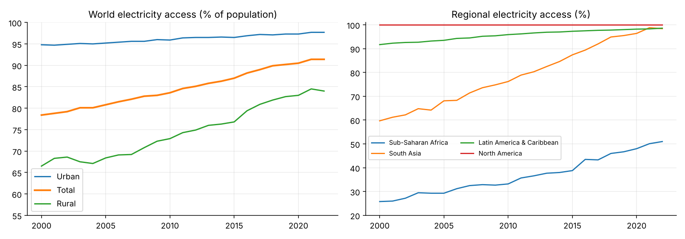
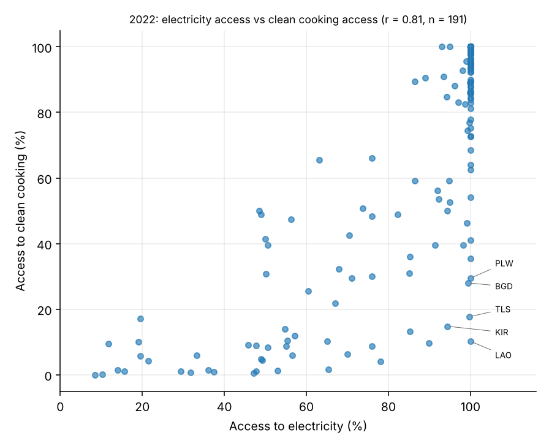
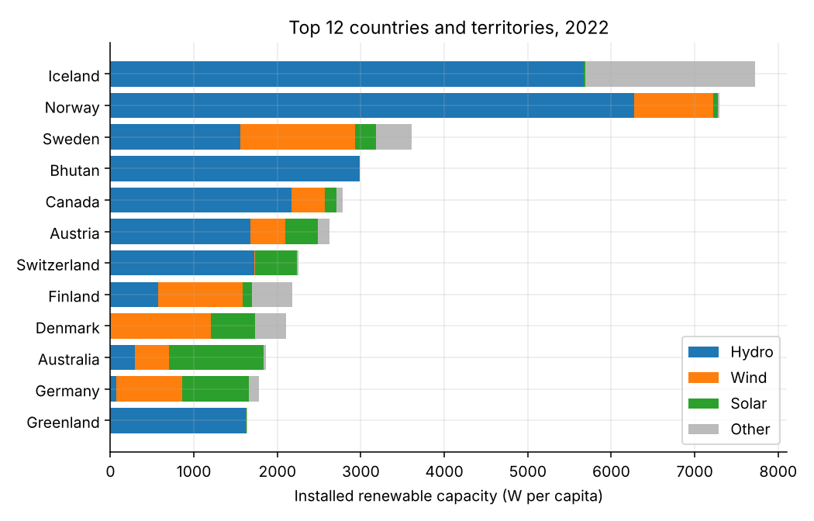

# SE4ALL Postgres Warehouse: a tested PostgreSQL data warehouse for SDG 7 energy data


This project turns the World Bank Sustainable Energy for All database (electricity access, clean cooking, renewables, energy efficiency and climate finance, 1990 to 2022, 239 areas) into a PostgreSQL star schema with data quality rules, analytics and tests.

It is a portfolio project in data engineering and analytics. Everything runs from plain SQL scripts and a few Python checks.

## What this demonstrates

| Skill | Evidence |
|---|---|
| Data profiling and cleaning | 19 constant columns, garbled characters in one area name, aggregates mixed with countries, a unit anomaly in the source metadata. See [`docs/DATA_DICTIONARY.md`](docs/DATA_DICTIONARY.md) |
| Dimensional modelling | Star schema with surrogate keys, primary key equal to the grain, CHECK and foreign key rules, a fact table partitioned by decade. See [`sql/01_schema.sql`](sql/01_schema.sql) |
| Repeatable ETL | Staging to warehouse in one transaction with a row-count check. The whole pipeline runs twice in CI. See [`sql/03_transform_load_dw.sql`](sql/03_transform_load_dw.sql) |
| Data quality engineering | 12 rules (ERROR, WARN, INFO) as a queryable view and a gate that fails the run. See [`sql/05_data_quality.sql`](sql/05_data_quality.sql) |
| Advanced SQL | CTEs, window functions, FILTER pivots, ROLLUP, ordered-set aggregates, regression functions, LATERAL, DISTINCT ON and a materialised view. See `sql/07` to `sql/09` |
| Physical design | Partition pruning and composite and partial indexes, with the plans in [`docs/PERFORMANCE.md`](docs/PERFORMANCE.md). The sample is small, so the plans show intent and not speed |
| Access control | A read-only role that can query the marts but cannot write or read staging |
| Testing | An independent pandas check of the results, a test that PostgreSQL returns the same answers, and GitHub Actions on a real PostgreSQL 16 service |

## Setup

You need PostgreSQL 14 or later and Python 3.10 or later. Run every command from the repository root.

### Option 1: local PostgreSQL, no Docker

```bash
createdb se4all
pip install -r requirements.txt

# Sample data (13 areas, runs in seconds)
psql -d se4all -v csv_path="'data/sample/WB_SE4ALL_sample.csv'" -v out_dir=results/sample -f sql/run_all.sql

# Full data: save the World Bank CSV as data/raw/WB_SE4ALL.csv first (see docs/DATA_SOURCES.md)
psql -d se4all -f sql/run_all.sql
```

### Option 2: Docker and make

```bash
make up
make all CSV=data/sample/WB_SE4ALL_sample.csv    # sample
make all                                          # full data in data/raw/WB_SE4ALL.csv
```

With `make`, use your own PostgreSQL by passing the psql command: `make all PSQL="psql -d se4all -v ON_ERROR_STOP=1"`.

Runs on the sample write to `results/sample` and `figures/sample`. Runs on the full file write to `results` and `figures`. The two never overwrite each other.

### Tests

```bash
python3 tests/crosscheck.py data/sample/WB_SE4ALL_sample.csv              # no database needed
make compare CSV=data/sample/WB_SE4ALL_sample.csv PSQL="psql -d se4all -v ON_ERROR_STOP=1"   # PostgreSQL against the pandas check
```

## Usage example

```sql
-- Electricity access in Kenya, total, urban and rural
SELECT year, elec_access_pct, elec_access_urban_pct, elec_access_rural_pct
FROM mart.v_country_year
WHERE iso3 = 'KEN' AND year >= 2018
ORDER BY year;

-- Data quality rules and how many rows fail each one
SELECT check_id, severity, failed_rows FROM dq.check_results ORDER BY severity, check_id;

-- A reusable function
SELECT * FROM mart.fn_country_profile('KEN') WHERE year = 2022;
```

## Folder structure

```
sql/        numbered pipeline scripts 01 to 11, plus run_all.sql
tests/      crosscheck.py (pandas check), compare_postgres.py, sample_assertions.sql
python/     make_figures.py
data/       sample/ (13-area extract, committed) and raw/ (full file, not committed)
results/    analytics tables and exports for the full data. results/sample is generated
figures/    charts used below
docs/       DATA_DICTIONARY.md, DATA_SOURCES.md, DESIGN.md, PERFORMANCE.md
.github/    CI workflow
```

Design choices and trade-offs are in [`docs/DESIGN.md`](docs/DESIGN.md).

## Findings

These come from the full dataset. The tables are in [`results/analytics/`](results/analytics/).

**1. Global electricity access rose from 78.4% in 2000 to 91.4% in 2022.** The world figure did not change between 2021 and 2022 (91.4% in both years) and the rural figure fell from 84.5% to 84.0%. In 2022, urban access was 97.7% and rural access was 84.0%.



**2. Sub-Saharan Africa had 51.0% access in 2022.** The other regional aggregates were South Asia 98.4%, Latin America and Caribbean 98.6% and North America 100.0%. Of the 218 countries with a 2022 value, 22 (10.1%) are below 50% and 141 (64.7%) are at or above 99.5%.

**3. Fastest electrifiers, 2000 to 2022:** Timor-Leste (+81.9 percentage points), Afghanistan (+80.9), Cambodia (+75.7), Solomon Islands (+71.3) and Bhutan (+68.8).

**4. Largest urban and rural gaps in 2022:** Equatorial Guinea (89.8% urban, 1.4% rural), Mali (99.7% and 18.3%) and Mozambique (79.4% and 5.0%).

**5. Some countries are electrified but cook with polluting fuels.** Across 191 countries the two measures rise together (r = 0.81). The exceptions in 2022 include Lao PDR (100% electricity, 10.2% clean cooking), Timor-Leste (99.7% and 17.7%), Kiribati (94.4% and 14.8%) and Bangladesh (99.4% and 28.0%).



**6. Climate finance commitments, 2000 to 2022.** India had the largest international financial commitments for renewable energy: USD 18.2 billion in 2020 prices, 8.8% of the total for countries with data. Pakistan followed with USD 9.5 billion and Lao PDR with USD 8.8 billion. These are commitments to developing countries, not money received or spent.

**7. Renewable share of final energy, 1990 to 2021.** The biggest rises were Estonia (+34.5 percentage points), Denmark (+32.5) and Lithuania (+30.1). The biggest falls were Equatorial Guinea (84.7% to 5.3%) and Viet Nam (75.9% to 24.2%). The share counted as modern renewables barely moved in those two countries (Equatorial Guinea 0.1% to 1.8%, Viet Nam 19.8% to 21.6%), so the falls come from the part that is not modern renewables. The data does not say more than that.

**8. Installed renewable capacity per person, 2022.** Iceland (7,722 W), Norway (7,296 W), Sweden (3,606 W), Bhutan (2,985 W) and Canada (2,779 W) lead. Hydropower is 86.0% of Norway's capacity and 99.9% of Bhutan's.



## Data quality results (full file)

All 9 ERROR rules pass with 0 failures. The source flags 2,512 values as missing. They stay as NULL and are never filled in. The data also holds 222 country-years where rural access is higher than urban access, and 19 where the national total sits outside its urban and rural range. These are shown as source anomalies and are not corrected.

## How the results were checked

| What | How | Result |
|---|---|---|
| All 11 SQL scripts | Run on PostgreSQL 16.15 with the 13-area sample, from an empty database and then a second time | Pass. 7,801 rows reconcile |
| 12 analytics queries | Compared with an independent pandas calculation (`tests/crosscheck.py`) and then with PostgreSQL output (`tests/compare_postgres.py`) | Equal |
| Data quality gate | Injected a percentage of 150 and a garbled area name | The gate stops the run in both cases |
| Read-only role | Tried to read the marts, then write to the fact table, then read staging and audit | Read works. The other three are refused |
| Findings above | Recomputed from `results/country_year.csv` | All numbers match the result files |

GitHub Actions repeats the sample run on every push.

The files in `results/` were produced by `tests/crosscheck.py` from the full file. To confirm that PostgreSQL gives the same answers on the full file, save the CSV as `data/raw/WB_SE4ALL.csv`, run `make all` and then `make compare`.

## Limitations and next steps

1. The list of regional aggregates is written into the code. Take it from World Development Indicators metadata instead.
2. Add population weights, so country figures can roll up to regions.
3. Forecast the year each country reaches universal access, with uncertainty. The linear projection in `sql/08_postgres_advanced.sql` is a baseline only.
4. Model access against income and finance with panel regression. Look for groups of countries with similar energy poverty.
5. Add incremental loads and a scheduler such as Airflow or dbt, and publish the marts to a dashboard.

## Data and licence

Data: World Bank, Sustainable Energy for All database, licensed CC BY 4.0. Source and download steps are in [`docs/DATA_SOURCES.md`](docs/DATA_SOURCES.md). Code: MIT, see [`LICENSE`](LICENSE).

## Contact

Chigozie Edwin Nlemeke (Chiggy). GitHub: [cnlemeke](https://github.com/cnlemeke).
