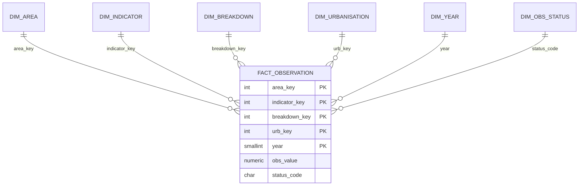

# Architecture & design decisions

Layers: `staging` (raw text) -> `dw` (typed star schema) -> `mart` (views / materialised view) ; `dq` (rules) ; `audit` (run log).

| Decision | Rationale | Trade-off |
|---|---|---|
| Staging table of TEXT | A load can never fail on dirty data; typing errors surface in a controlled, reconciled transform | one extra copy of the data |
| Star schema with surrogate keys | Measured on the raw file: 44.6% of bytes are constant columns and 37.8% repeated label text (82.5% combined); dimensions shrink the fact table and give one place to fix labels | joins; mitigated by the `mart.v_*` views |
| `RANGE (year)` partitioning by decade | Time-bounded queries prune partitions; partitions can be archived/detached | small dataset - chosen to demonstrate the pattern; a PK must include the partition key (it does) |
| PK = business grain; CHECK ties NULL value ⇔ status `O` | Duplicates and half-missing rows are impossible by construction | |
| `NUMERIC(20,8)` not `float` | exact decimal arithmetic. The source carries up to 6 real decimals (for example 0.000926 W per capita) plus float noise beyond 12 decimals, so 8 decimals keeps every real digit and drops the noise | slower than float, negligible here. An earlier `NUMERIC(18,4)` rounded real values |
| Rules as a view (`dq.check_results`) + `dq.assert_clean()` | Rules are queryable, versionable, usable as a CI gate | |
| Aggregates flagged, never summed with countries | Prevents double counting (World = Σ regions) | aggregate list is hard-coded; Phase 2 should source it from WDI metadata |
| Analytics in portable SQL where possible | Executable here against SQLite and cross-checked with pandas; PG-only features isolated in `08` | |

## Verification strategy (honest scope)
| Layer | How verified |
|---|---|
| Data profile, DQ tolerances | pandas on the full file |
| `05_data_quality`, `06_views`, `07_analytics` | **executed** (SQLite) by `tests/crosscheck.py`, results asserted against an independent pandas oracle |
| `01-04`, `08-11`, plpgsql functions, partitioning, `\copy` | executed on **PostgreSQL 16 by GitHub Actions** (`.github/workflows/ci.yml`) - check the first run |
